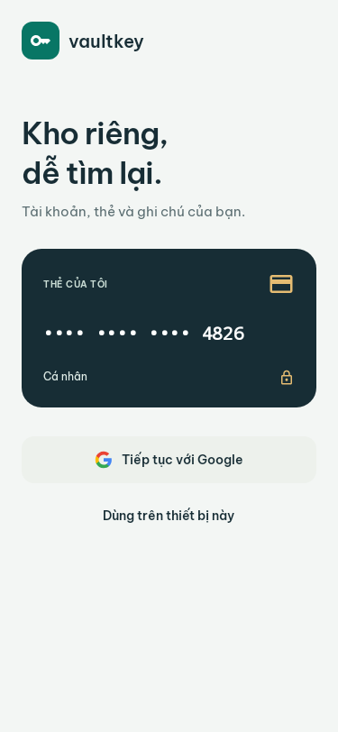
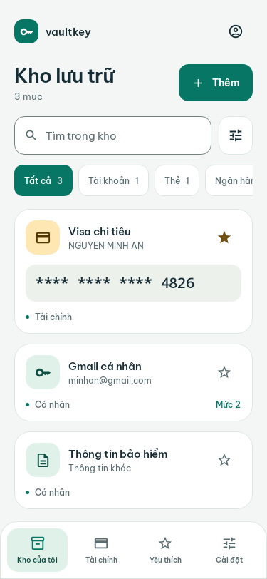
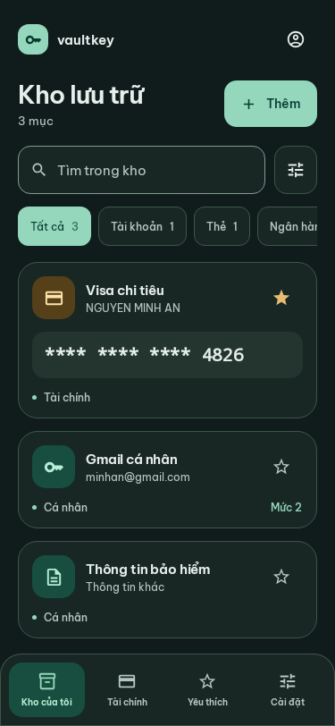
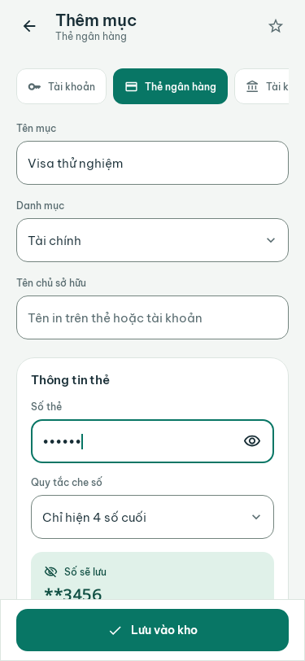
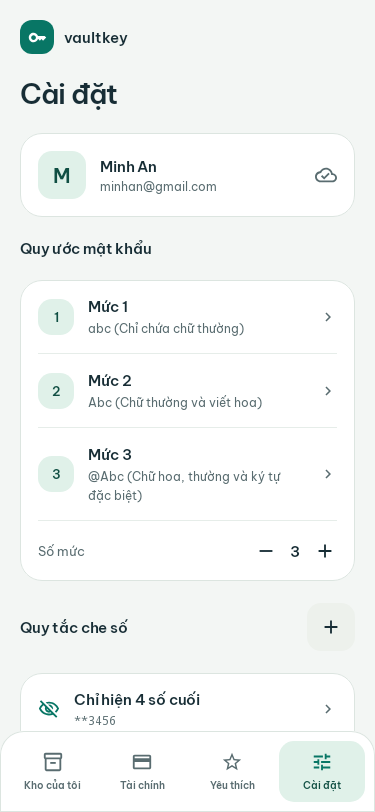
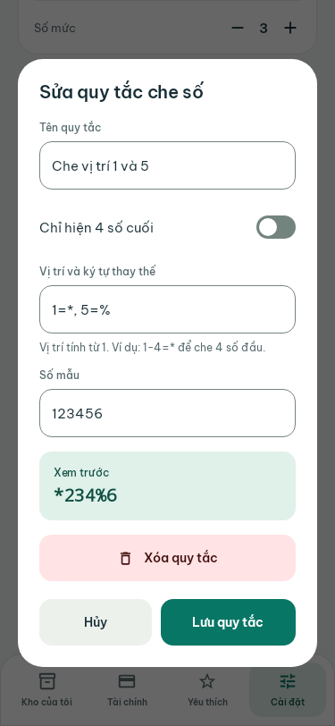

<p align="center">
  
</p>

<h1 align="center">VaultKey</h1>

<p align="center"><strong>Kho riêng, dễ tìm lại.</strong><br />Quản lý tài khoản, thẻ và thông tin cá nhân trên Android.</p>

<p align="center">
  <a href="https://github.com/NguynNe3110/Vault-Key/releases">Tải APK</a> ·
  <a href="#ảnh-giao-diện">Ảnh giao diện</a> ·
  <a href="#build-apk-release-có-chữ-ký">Build release</a> ·
  <a href="#tự-động-release-khi-push-tag">Phát hành</a>
</p>

Ứng dụng Android viết bằng **Kotlin, Jetpack Compose, Room và Firebase Authentication/Firestore**. Có thể dùng kho trên thiết bị mà không cần đăng nhập. Yêu cầu **Android 7.0 (API 24)** trở lên.

## Ảnh giao diện

Ảnh được render từ màn hình Compose thật bằng Robolectric / Roborazzi, sử dụng dữ liệu mẫu trong kiểm thử. Nút Google trong ảnh minh họa trạng thái đã cấu hình đăng nhập.

<table>
  <tr><th>Bắt đầu</th><th>Kho lưu trữ</th><th>Giao diện tối</th></tr>
  <tr>
    <td></td>
    <td></td>
    <td></td>
  </tr>
  <tr><th>Thêm thẻ</th><th>Cài đặt</th><th>Quy tắc che số</th></tr>
  <tr>
    <td></td>
    <td></td>
    <td></td>
  </tr>
</table>

## Chức năng

- Kho gồm tài khoản đăng nhập, thẻ ngân hàng, tài khoản ngân hàng và thông tin khác.
- Thêm, sửa, xóa có xác nhận; tìm kiếm không dấu; lọc theo loại/danh mục; yêu thích; sao chép từng trường.
- Giữ cách gợi nhớ mật khẩu theo mức. Có thể sửa tên, mô tả và dùng 1–10 mức.
- Tạo quy tắc che số theo vị trí, xem trước và chỉ lưu kết quả đã che. Ví dụ `1=*, 5=%`: `123456` → `*234%6`. Khoảng `1-4=*` được hỗ trợ. Vị trí đếm từ 1 trên chuỗi số nhập, khoảng trắng được loại bỏ. Mẫu mặc định chỉ hiện 4 số cuối.
- Số gốc chỉ tồn tại trong bộ nhớ của màn hình nhập; không vào saved state, Room, Firestore, log hoặc clipboard. Không có nút khôi phục số gốc. Sửa quy tắc không làm thay đổi các số đã lưu; cần nhập lại số để áp dụng quy tắc khác.
- Trường bổ sung được lưu như nội dung người dùng nhập. Không có trường lưu mật khẩu thật, PIN hay CVV.
- Giao diện tiếng Việt, sáng/tối theo hệ thống, biểu mẫu cuộn được khi mở bàn phím và khi tăng cỡ chữ.

## Cài đặt APK

1. Mở [GitHub Releases](https://github.com/NguynNe3110/Vault-Key/releases), tải `VaultKey-<phiên-bản>.apk` trong **Assets**.
2. Cho phép trình duyệt hoặc trình quản lý tệp cài APK khi Android yêu cầu, rồi mở tệp đã tải.
3. Chọn **Dùng trên thiết bị này**, hoặc đăng nhập Google nếu bản build đã cấu hình Firebase.

Mỗi release đính kèm tệp `.apk.sha256` để đối chiếu checksum. Bản debug và release dùng khóa ký khác nhau nên không cài đè được cho nhau. Nếu cần gỡ bản cũ, hãy giữ lại dữ liệu cần thiết trước: gỡ ứng dụng sẽ xóa kho chỉ lưu trên thiết bị.

## Chạy và kiểm tra

Cần **JDK 21**, Android SDK Platform **36.1**, Build-Tools **36.0.0**, Platform-Tools, Android Studio tương thích AGP **9.1.1** và mạng cho lần tải thư viện đầu tiên. Sử dụng Gradle wrapper **9.3.1** đã có trong repository. Khai báo đường dẫn SDK trong `local.properties` (`sdk.dir=...`) hoặc cấu hình môi trường Android SDK phù hợp.

```powershell
.\gradlew.bat :app:assembleDebug
.\gradlew.bat :app:testDebugUnitTest :app:lintRelease
.\gradlew.bat :app:testDebugUnitTest '-Proborazzi.test.record=true' --rerun-tasks
```

APK debug: `app/build/outputs/apk/debug/app-debug.apk`.
Ảnh QA: `app/build/reports/screenshots/`. Báo cáo kiểm thử: `app/build/reports/tests/testDebugUnitTest/index.html`.

Trên macOS/Linux, thay `.\gradlew.bat` bằng `bash ./gradlew`. Roborazzi render UI trên JVM, không yêu cầu emulator. Sau khi thay đổi giao diện, chạy lại lệnh record rồi chép các ảnh tương ứng từ thư mục báo cáo vào `docs/images/` để cập nhật README.

Cài và mở ứng dụng khi ADB đã kết nối điện thoại:

```powershell
adb devices -l
adb -s <IP:PORT> install --no-streaming -r app/build/outputs/apk/debug/app-debug.apk
adb -s <IP:PORT> shell am start -n com.example/.feature.MainActivity
```

`PORT` là cổng ở màn hình chính **Gỡ lỗi không dây**, có thể thay đổi sau mỗi lần bật lại. Cổng ghép đôi chỉ dùng cho `adb pair`. Trong Android Studio có thể chọn thiết bị rồi bấm Run.

Không cần Gemini API key để sử dụng các chức năng của kho.

## Build APK release có chữ ký

Trên Windows, **chỉ khởi tạo khóa khi phát hành ứng dụng mới lần đầu**:

```powershell
.\scripts\build-release.ps1 -InitializeSigning -VersionName 1.0.0
```

Script tạo khóa RSA riêng và mật khẩu ngẫu nhiên trong `.release-signing/`, build release và xác minh chữ ký bằng `apksigner`. Kết quả:

```text
dist/VaultKey-1.0.0.apk
dist/VaultKey-1.0.0.apk.sha256
```

Các lần build sau dùng lại khóa đã có:

```powershell
.\scripts\build-release.ps1 -VersionName 1.0.1
adb install -r .\dist\VaultKey-1.0.1.apk
```

**Sao lưu an toàn toàn bộ `.release-signing/`**, gồm `vaultkey-release.jks` và `credentials.json`. Thư mục này cùng `dist/` đã bị loại khỏi Git. Không đưa khóa hoặc mật khẩu vào commit hay release asset. Bản cập nhật phải dùng lại khóa của bản đã phát hành; script từ chối ghi đè khóa hiện có.

Nếu đã có khóa riêng, đặt `KEYSTORE_PATH`, `STORE_PASSWORD`, `KEY_ALIAS`, `KEY_PASSWORD` trong môi trường tiến trình rồi build trực tiếp:

```powershell
.\gradlew.bat :app:assembleRelease -PversionName=1.0.0 -PversionCode=1000000 --no-configuration-cache
```

APK đã ký nằm tại `app/build/outputs/apk/release/app-release.apk`. Khi chưa cung cấp khóa, Gradle có thể tạo APK **unsigned**; tệp đó chưa dùng làm bản cài đặt phát hành được. Không bắt buộc có `google-services.json` để build và dùng kho trên thiết bị.

## Tự động release khi push tag

Workflow [`.github/workflows/release.yml`](.github/workflows/release.yml) chạy khi push tag có tiền tố `v`, chấp nhận phiên bản ổn định dạng **`vMAJOR.MINOR.PATCH`**, ví dụ `v1.0.0`.

### Thiết lập một lần

Trong repository GitHub, mở **Settings → Secrets and variables → Actions → New repository secret**:

| Secret | Giá trị |
| --- | --- |
| `KEYSTORE_BASE64` | Toàn bộ tệp khóa ký, mã hóa Base64 |
| `STORE_PASSWORD` | Mật khẩu keystore |
| `KEY_ALIAS` | Alias của khóa; script mặc định tạo `upload` |
| `KEY_PASSWORD` | Mật khẩu của khóa |
| `GOOGLE_SERVICES_JSON_BASE64` | Tệp `app/google-services.json` mã hóa Base64; tùy chọn nếu chỉ phát hành kho cục bộ |

Với khóa tạo bằng script ở trên, có thể cấu hình qua [GitHub CLI](https://cli.github.com/) mà không sao chép mật khẩu ra màn hình:

```powershell
gh auth login
.\scripts\set-release-secrets.ps1 -Repository NguynNe3110/Vault-Key
```

Script đưa bốn secret ký APK lên repository; nếu có `app/google-services.json` thì đưa cả cấu hình Firebase lên. Dùng `-Repository owner/repo` của bạn khi làm việc trên fork. Workflow sử dụng `GITHUB_TOKEN` tự cấp với quyền `contents: write`, không cần lưu PAT riêng. Cách tạo release theo [tài liệu GitHub CLI](https://cli.github.com/manual/gh_release_create).

### Phát hành

Commit và push các thay đổi cùng workflow trước, sau đó tạo tag trên commit muốn phát hành:

```powershell
git tag -a v1.0.0 -m "VaultKey 1.0.0"
git push origin v1.0.0
```

Workflow sẽ:

1. Checkout đúng commit của tag, cài JDK/SDK và kiểm tra Gradle wrapper.
2. Khôi phục khóa từ Secrets; thiếu secret ký sẽ dừng và chỉ rõ tên cần bổ sung.
3. Chạy unit/UI test bằng Robolectric, lint release và build APK có chữ ký.
4. Xác minh chữ ký, đặt tên APK theo tag và tạo checksum SHA-256.
5. Tạo GitHub Release với ghi chú tự sinh, đính kèm APK và checksum. Chạy lại cho cùng tag sẽ cập nhật hai asset.

`versionName` lấy từ tag, bỏ `v`. `versionCode = MAJOR × 1.000.000 + MINOR × 1.000 + PATCH`; `MAJOR` tối đa 2099, `MINOR` và `PATCH` tối đa 999; không dùng `v0.0.0`. Ví dụ `v1.0.1` có `versionCode=1000001`. Luôn tăng phiên bản để Android nhận bản cập nhật. Tag prerelease như `v1.0.0-rc.1` chưa được hỗ trợ.

Theo dõi tại **Actions → Release APK**. Chỉ xuất bản khi test, lint, build và xác minh chữ ký đều thành công.

## Cấu hình đăng nhập Google

Luồng sử dụng Android Credential Manager (`GetSignInWithGoogleOption`) và Firebase Auth, có phục hồi phiên đăng nhập, hủy đăng nhập và xóa trạng thái lựa chọn tài khoản khi đăng xuất.

1. Trong Firebase Console của dự án tương ứng, mở Authentication → Sign-in method và bật Google.
2. Chạy `.\gradlew.bat :app:signingReport`. Đăng ký SHA-1 và SHA-256 của khóa debug; thêm khóa release/Play App Signing trước khi phát hành.
3. Kiểm tra Android app có package `com.example`, tải lại `google-services.json` và đặt tại `app/google-services.json`. File cần có Web OAuth client ID (loại 3) cho `default_web_client_id`, cùng Android OAuth client đúng package/chữ ký.
4. Tạo Firestore và áp dụng quy tắc trong `firestore.rules` bằng Console hoặc công cụ Firebase của bạn. Chỉ chủ tài khoản có quyền truy cập `/users/{uid}/…`.
5. Chạy trên thiết bị hoặc emulator có Google Play services và tài khoản Google. Kiểm tra đăng nhập, lưu, đồng bộ, đăng xuất rồi đăng nhập lại.

`app/google-services.json.example` chỉ là tệp tham khảo. Việc bật provider, đăng ký chữ ký và triển khai quyền Firestore cần thực hiện trên dự án Firebase thực. Với Actions, cập nhật secret Firebase sau khi thay đổi cấu hình. Xem thêm [hướng dẫn ký ứng dụng Android](https://developer.android.com/studio/publish/app-signing).

Tài liệu chính thức: https://firebase.google.com/docs/auth/android/google-signin và https://developer.android.com/identity/sign-in/credential-manager-siwg.

## Lưu trữ và đồng bộ

Kho không đăng nhập dùng `vault_database`, được nâng cấp từ schema 1 lên 2 bằng migration, giữ nguyên các tài khoản và mức mật khẩu cũ. Mỗi Google UID dùng database và cấu hình riêng. Kho trên thiết bị không tự động đưa lên tài khoản Google. Tài khoản cũ trên đám mây được tải về kho Google của chính tài khoản đó.

Đồng bộ gộp mục theo UUID và `updatedAt`; giữ tombstone cho mục/quy tắc đã xóa. Mỗi lần thêm/sửa/xóa hoặc thay đổi cài đặt sẽ tự xếp yêu cầu đồng bộ ngay sau khi lưu Room, không cần thao tác thủ công. Hàng đợi chạy tuần tự, giữ lượt gửi tiếp nếu người dùng sửa trong khi đang tải lên. Lỗi mạng tự thử lại với khoảng chờ tăng dần tối đa 60 giây; có mạng trở lại hoặc mở lại ứng dụng sẽ tự gửi tiếp. Trạng thái thu gọn thành biểu tượng trong Cài đặt; khi cần xử lý mới hiện thông báo và nút Thử lại. Chi tiết lỗi Firebase giữ ở tầng dữ liệu, không đưa mã lỗi kỹ thuật vào giao diện. Chỉ báo thành công sau khi Firestore xác nhận. Không tự xóa toàn bộ dữ liệu trên máy khi tải từ cloud.

Nếu báo `PERMISSION_DENIED`, kiểm tra và Publish [quy tắc Firestore](firestore.rules) cho đúng dự án/database trong Firebase Console. Các file rules trong mã nguồn không tự triển khai lên Firebase.

Room và các trường bổ sung hiện không có mã hóa đầu cuối hoặc khóa sinh trắc học. Google xác thực tài khoản và quyền Firestore; không thay thế khóa mở ứng dụng. Android Auto Backup và chuyển dữ liệu tự động bị loại trừ để kho trên thiết bị không bị sao lưu ngoài luồng đồng bộ đã chọn. Gỡ ứng dụng sẽ xóa dữ liệu chỉ lưu trên thiết bị.

## Thiết kế

Giao diện tối giản và ưu tiên nội dung. Bộ nút, ô nhập, lựa chọn, điều hướng, thông báo và hộp thoại được tạo chung trong `ui`, dùng font Be Vietnam Pro đóng gói sẵn, token sáng/tối và vùng chạm tối thiểu 48dp. Danh sách bắt đầu trực tiếp bằng tìm kiếm và nội dung. Thông tin về font và biểu tượng Google nằm trong [THIRD_PARTY_NOTICES.md](THIRD_PARTY_NOTICES.md).

## Kiến trúc MVVM

Source root: `app/src/main/java/com/example/`. Giữ package hiện có để tương thích Firebase và dữ liệu đã cài.

| Nhóm | Trách nhiệm |
| --- | --- |
| `core` | Manual DI qua `AppContainer`, adapter đăng nhập Google và helper lifecycle |
| `data` | Room entity/DAO, Firebase data source, mapper, repository implementation và hàng đợi đồng bộ |
| `domain` | Model thuần Kotlin, repository interface và use case lưu/che số |
| `feature` | Login, Home, Editor, Settings, Detail và vỏ Main; UiState/UiEvent/UiEffect nằm cùng tính năng |
| `ui` | Component, dialog, icon, navigation và theme dùng chung |

`MyApp` là Application duy nhất. `feature/MainActivity` khởi tạo Compose; `ui/navigation/VaultNavHost` lắp các màn hình. ViewModel chỉ nhận hợp đồng `domain`, không truy cập DAO, Firebase hay repository implementation. Room entity và JSON được chuyển đổi tại `data/mapper`; domain và UI không dùng entity làm hợp đồng dữ liệu. Không thêm module Gradle hoặc framework DI.
